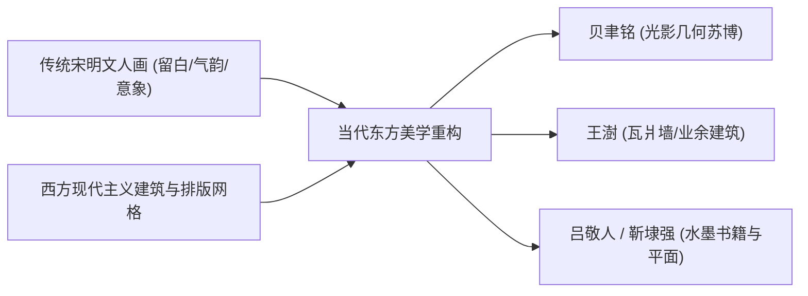

# 全球近现代设计美学与文字叙事风格全景图谱

本项目整理并构建了贯通全球多元文化体系的近现代设计美学、视觉流派与文字叙事修辞的百科全书式知识库。内容涵盖中华/华人系统、东亚日本体系、拉美热带现代主义、伊斯兰几何现代主义以及欧美现代主义等20种核心视觉体系与16种传世文字修辞范式。

> 📌 **项目工程化推进状态看板**：
> 本知识库已全面转化为可直接在反重力 (Antigravity) 等 AI 软件中调用的标准 Skill 语料库与「分析/设计」双核心接口。
> - 实时开发进度看板：👉 [**查看详细开发看板 (PROGRESS.md - 100% 竣工)**](file:///f:/ai风格设计/PROGRESS.md)
> - 系统架构与开发总纲：👉 [**查看系统架构总纲 (DESIGN_SKILLS_FRAMEWORK.md)**](file:///f:/ai风格设计/DESIGN_SKILLS_FRAMEWORK.md)
> - 全量特征索引字典：👉 [**查看全量语料库索引 (corpus_index.json)**](file:///f:/ai风格设计/corpus_index.json)
> - 技能语料库存储路径：👉 [`skills/`](file:///f:/ai风格设计/skills/) (20 视觉 + 16 叙事语料库已全部就绪)
> - **反重力双核心接口**：
>   - 接口 1：👉 [`skills/interfaces/style-analyzer/`](file:///f:/ai风格设计/skills/interfaces/style-analyzer/SKILL.md) (风格溯源、DNA提取与 5 维同质化诊断)
>   - 接口 2：👉 [`skills/interfaces/style-designer/`](file:///f:/ai风格设计/skills/interfaces/style-designer/SKILL.md) (自主情境匹配、严格流派锁定与工业级 Prompt 调度)

---

## 目录导览

- [前言：多极化世界中的形态与语义](#前言多极化世界中的形态与语义)
- [第一篇：东方与中华美学近现代设计谱系](#第一篇东方与中华美学近现代设计谱系)
  - [1. 民国海派与月份牌设计美学 (Haipai & Yuefenpai, 1910s-1940s)](#1-民国海派与月份牌设计美学)
  - [2. 新中国社会主义现实主义与工农兵工业美学 (1950s-1970s)](#2-新中国社会主义现实主义与工农兵工业美学)
  - [3. 当代东方意境、文人写意与“新中式” (Contemporary Neo-Chinese & Literati Zen)](#3-当代东方意境文人写意与新中式)
  - [4. 新国潮与东方赛博机能 (Neo-Chinese Guochao & Cyberpunk Orientalism)](#4-新国潮与东方赛博机能)
- [第二篇：东亚与全球非欧美区域代表性美学](#第二篇东亚与全球非欧美区域代表性美学)
  - [5. 日本传统哲思与现代平面体系 (Wabi-Sabi, Yūgen & Superflat)](#5-日本传统哲思与现代平面体系)
  - [6. 拉美热带现代主义 (Tropical Modernism: 墨西哥与巴西)](#6-拉美热带现代主义)
  - [7. 伊斯兰几何现代主义与当代阿拉伯书写艺术 (Islamic Geometric Modernism & Calligraffiti)](#7-伊斯兰几何现代主义与当代阿拉伯书写艺术)
- [第三篇：欧美近现代设计美学核心流派演进 (1860s - 2020s)](#第三篇欧美近现代设计美学核心流派演进)
  - [8. 工艺美术运动 (Arts and Crafts Movement)](#8-工艺美术运动)
  - [9. 新艺术运动 (Art Nouveau / Jugendstil)](#9-新艺术运动)
  - [10. 构成主义与风格派 (Constructivism & De Stijl)](#10-构成主义与风格派)
  - [11. 包豪斯与功能主义体系 (Bauhaus & Functionalism)](#11-包豪斯与功能主义体系)
  - [12. 装饰艺术风格 (Art Deco)](#12-装饰艺术风格)
  - [13. 国际主义平面设计风格 / 瑞士风格 (Swiss Style)](#13-国际主义平面设计风格--瑞士风格)
  - [14. 中世纪现代主义 (Mid-Century Modern, MCM)](#14-中世纪现代主义)
  - [15. 波普艺术与迷幻视觉 (Pop Art & Psychedelic)](#15-波普艺术与迷幻视觉)
  - [16. 粗野主义与反设计 (Brutalism & Anti-Design)](#16-粗野主义与反设计)
  - [17. 后现代主义与孟菲斯风格 (Postmodernism & Memphis Group)](#17-后现代主义与孟菲斯风格)
  - [18. 90年代垃圾摇滚排版与酸性设计 (Grunge & Acid Graphics)](#18-90年代垃圾摇滚排版与酸性设计)
  - [19. 数字交互三次浪潮 (Skeuomorphism, Flat & Glassmorphism)](#19-数字交互三次浪潮)
  - [20. 千禧未来主义与赛博朋克谱系 (Y2K & Cyberpunk)](#20-千禧未来主义与赛博朋克谱系)
- [第四篇：近现代多元文字语言与文案叙事流派](#第四篇近现代多元文字语言与文案叙事流派)
  - [【中文语系与东方叙事】](#中文语系与东方叙事)
    - [1. 鲁迅式“冷峻硬骨与匕首讽喻体”](#1-鲁迅式冷峻硬骨与匕首讽喻体)
    - [2. 张爱玲式“世俗苍凉与繁复工笔”](#2-张爱玲式世俗苍凉与繁复工笔)
    - [3. 汪曾祺与阿城式的“民间风物与洗练白描体”](#3-汪曾祺与阿城式的民间风物与洗练白描体)
    - [4. 王家卫式“时间延宕与都市疏离叙事”](#4-王家卫式时间延宕与都市疏离叙事)
    - [5. 许舜英的“后现代意识流与消费符号学”](#5-许舜英的后现代意识流与消费符号学)
    - [6. 李欣频的“诚品文学感官通感与文化避难所”](#6-李欣频的诚品文学感官通感与文化避难所)
    - [7. 当代新东方风土嗅觉体 (以观夏、步步高、茶颜为例)](#7-当代新东方风土嗅觉体)
    - [8. 叶茂中式的“冲突论与铁锤认知穿透体”](#8-叶茂中式的冲突论与铁锤认知穿透体)
  - [【欧美经典与全球叙事】](#欧美经典与全球叙事)
    - [9. 奥格威的事实纪实流 (The Ogilvy Fact-Dense Style)](#9-奥格威的事实纪实流)
    - [10. 伯恩巴克的自嘲与反常识哲学 (Bernbach's DDB Negative Framing)](#10-伯恩巴克的自嘲与反常识哲学)
    - [11. 尼尔·法兰奇的傲慢贵族式长文案 (Neil French's Cynicism)](#11-尼尔法兰奇的傲慢贵族式长文案)
    - [12. 海明威电报体与冰山极简法则 (Hemingway's Telegraphic Minimalism)](#12-海明威电报体与冰山极简法则)
    - [13. 威登肯尼迪的存在主义身体叙事 (Wieden+Kennedy's Existential Epicism)](#13-威登肯尼迪的存在主义身体叙事)
    - [14. 乔布斯与西格尔的激进清澈体 (Jobs & Segall's Radical Clarity)](#14-乔布斯与西格尔的激进清澈体)
    - [15. 普鲁斯特式微观心理通感 (Proustian Sensory Synesthesia)](#15-普鲁斯特式微观心理通感)
    - [16. 日系生活微粒与物哀克制叙事 (Japanese Everyday Poetics & Restraint)](#16-日系生活微粒与物哀克制叙事)
- [第五篇：全球设计美学与文字修辞的跨媒介对应大矩阵](#第五篇全球设计美学与文字修辞的跨媒介对应大矩阵)

---

## 前言：多极化世界中的形态与语义

人类的设计与文字并非欧美单一文明的单线演进，而是由**西方工业现代性**、**东方文人哲思与意境传统**、**亚非拉在地热带风土与民间活力**共同谱写的复调乐章。

- **西方现代设计**偏向以**理性、网格、结构、功能与技术革命**为底层逻辑；
- **东方中华设计**深植于**气韵生动、天人合一、计白当黑、意象互渗**的宇宙观；
- **拉美与亚非拉设计**则展现了**狂烈热带色彩、有机泥土塑形、反殖民原住民神话**的激荡。

文字亦然，从汉字的象形音意到西方拼音文字的逻辑严密，在近现代淬炼出了风格迥异但心神相通的叙事流派。

---

## 第一篇：东方与中华美学近现代设计谱系

```
[民国海派与月份牌 (1910s-40s)] ─── 中西折衷与十里洋场市民摩登
        │
        ▼
[新中国社会主义现实主义 (1950s-70s)] ─── 红色叙事、英雄仰角与工农兵力量
        │
        ▼
[当代东方写意 / 新中式 (1980s-至今)] ─── 计白当黑、文人骨气与当代空间重构
        │
        ▼
[新国潮与东方未来机能 (2018-至今)] ─── 传统纹样解构、宋明气象与数码赛博融合
```

---

### 1. 民国海派与月份牌设计美学
*时期：1910s – 1940s*

#### 核心哲学与美学关键词
- **哲学精髓**：上海开埠后中西商业文明剧烈碰撞的产物。将中国传统工笔年画的吉庆民俗，与西方透视明暗技法、装饰艺术（Art Deco）及好莱坞摩登风潮熔铸一炉，开创了近代中国第一套成熟的商业视觉与消费文化体系。
- **关键词**：**擦笔水彩画法 (Airbrush-watercolor)**、**甜润丰腴 (Svelte and luminous)**、**中西折衷旗袍装**、**石库门摩登**、**民国老美术字 (Vintage Chinese typography)**。

#### 多领域视觉表现
- **图像与封面设计**：
  - 郑曼陀、杭穉英（穉英画室）开创的**擦笔水彩月份牌**：细腻丰润的摩登名媛、高光缎面改良旗袍、进口留声机、西式客厅背景与中国传统如意边框交融。
  - 鲁迅为《奔流》《呐喊》等书刊题写的带有六朝金石气、碑帖筋骨的早期汉字美术字。
- **建筑与空间设计**：
  - **上海石库门里弄**（中式江南民居“天井-四合房”与西式联排建筑排门、山花雕饰的结合）。
  - 拉斯洛·邬达克（László Hudec）设计的上海国际饭店、大光明电影院与“绿房子”（融入远东第一装饰艺术风格的摩登公寓）。

#### 采用对应美学的当代品牌与机构
- **双妹 (Shanghai Vive, 1898)**：百年上海名媛美学，保留月份牌双生名媛经典视觉，当代重塑为高端海派护肤香氛。
- **百雀羚 (Pechoin - 三生花系列)**：重新提取民国海派插画与复古扁平圆铁盒装帧，唤起国民记忆。
- **大佛龙井 / 民国风茶饮**：大量采用做旧宣纸、民国老报纸宋体裁切、双色石版套印风格包装。

---

### 2. 新中国社会主义现实主义与工农兵工业美学
*时期：1950s – 1970s*

#### 核心哲学与美学关键词
- **哲学精髓**：以苏联社会主义现实主义结合中国民间木刻年画传统，艺术服务于人民工农兵与社会主义工业化建设。视觉充满无产阶级力量感、革命乐观主义与对重工业机器的赞歌。
- **关键词**：**红光亮、高大全 (Red, Bright, Towering)**、**新兴木刻版画刀锋感 (Woodcut blade texture)**、**仰视英雄视角 (Heroic low-angle)**、**红砖苏式厂房**、**毛体书法与刚健黑体**。

#### 多领域视觉表现
- **图像海报与宣传画**：
  - 哈琼文《毛主席万岁》（母亲怀抱婴儿）、沈绍伦等大师作品：人物肌肉强健、红光满面、目光坚毅望向地平线曙光，红黄主色调统治画面。
  - 李桦、古元等发源自延安的新兴木刻版画：黑白对比刀砍斧凿、粗犷线条、泥土气息。
- **封面与出版**：《人民画报》《红旗》杂志封面；工整刚劲的铁线手绘黑体；经典的红黄双色机械齿轮与麦穗徽章。
- **建筑与工业品**：
  - 首都“建国十周年十大建筑”（**人民大会堂、中国历史博物馆**）：将中国传统多层檐口与重檐歇山顶意象，融入苏式宏大廊柱体量中。
  - **红旗牌轿车 (CA770)**：扇形水箱格栅（取材于中式折扇）、宫灯造型尾灯、方向盘中央向日葵纹样。

#### 采用对应美学的当代品牌与机构
- **永久牌自行车 & 飞跃球鞋 (Feiyue)**：保留原汁原味50年代工业标准硬朗蓝白红标与钢架几何。
- **大白兔奶糖**：经典的红白蓝三色糖纸，半透明米纸包裹，承载社会主义计划经济时期的温情工业设计。
- **红星二锅头**：军绿磨砂瓶、五角星标与硬朗工业排版，成为时代硬汉符号。

---

### 3. 当代东方意境、文人写意与“新中式”
*时期：1980s – 至今*



#### 核心哲学与美学关键词
- **哲学精髓**：从老庄哲学的“大音希声、大象无形”与宋明文人画的“逸格”出发，抵抗西方消费主义符号的粗暴堆叠。不画龙画凤，而是用**光影、材质、留白与呼吸感**表达当代的东方精神。
- **关键词**：**计白当黑 (Emptiness as substance)**、**气韵生动 (Rhythmic vitality)**、**天人合一 (Unity of nature and man)**、**瓦石灰度 (Ash, Bamboo, Raw silk)**、**宋画克制风骨**。

#### 多领域视觉表现
- **书籍与平面视觉**：
  - **吕敬人**（书籍装帧泰斗）的“书戏”理念：融合宣纸折页、线装工艺、压凹无墨、毛边撕裂感，使翻书成为多维感官体验。
  - **靳埭强**（香港设计之父）：将中国传统水墨的干湿浓淡与西方现代主义严谨网格融合，墨滴与直尺并置。
  - **陈幼坚**（Alan Chan）：“东情西韵”，巧妙将茶叶、书法笔画解构为当代商业标识。
- **建筑与空间设计**：
  - **贝聿铭**的**苏州博物馆新馆**：用深灰色花岗岩线条取代传统木结构飞檐，以几何多边形重构江南粉墙黛瓦，在天光水影中再现宋代文人园林意境。
  - **王澍**（普利兹克奖得主）的**中国美院象山校区 / 宁波历史博物馆**：回收百万块旧城拆迁的瓦砾残砖构筑“瓦爿墙”，让建筑沉淀出土地与历史废墟的深沉肌理。
  - **马岩松**（MAD 建筑事务所）的“山水城市”构想：哈尔滨大剧院如同一座被雪原风力自然雕塑出的流线雪丘。

#### 采用对应美学的当代品牌与机构
- **观夏 (To Summer)**：中国当代沙龙香氛代表。其器皿由工匠手工吹制，店内陈列高山流水白砂石与未经抛光的原始岩块，视觉留白达80%以上。
- **上下 (SHANG XIA)**：爱马仕集团投资创立的当代中式顶奢，主打紫檀、大漆、竹丝扣瓷与薄胎白瓷的极简当代转化。
- **素元 / 梵几**：独立原创家具品牌，剔除清式家具的繁缛雕花，保留明式家具极其修长利落的榫卯线条骨相。
- **茶颜悦色 / 霸王茶姬**：新茶饮视觉体系中，将故宫藏画、宋徽宗赵佶瘦金体书法与当代印金插画进行现代快消品转译。

---

### 4. 新国潮与东方赛博机能 (Neo-Chinese Guochao & Cyberpunk Orientalism)
*时期：2018 – 至今*

#### 核心哲学与美学关键词
- **哲学精髓**：伴随中国本土文化自信觉醒与数码生成艺术爆发，年轻一代设计师将中国传统古老图腾（山海经、甲胄、道家符箓、汉字偏旁部首）与赛博朋克、机能风（Techwear）、3D金属渲染深度重组。
- **关键词**：**汉字结构异化**、**东方神怪机甲化**、**朱砂红与机能黑高反差**、**云雷纹数码重构**、**马面裙机能改良**。

#### 多领域视觉表现
- **图像海报与视觉设计**：将楷书与隶书字形强行拉伸、加入金属锐利尖角或电路板镂空；运用高反差黑底配以朱砂红、激光绿、琉璃金。
- **时尚与产品包装**：
  - **花西子 (Florasis)**：在口红膏体与眼影粉饼上运用中国传统“微雕工艺”，重现《洛神赋》《百鸟朝凤》浮雕；外壳采用黛色与轩窗几何。
  - **中国李宁 (巴黎时装周秀场系列)**：将“中国李宁”繁体方正汉字作为超级视觉符号，结合机能战术绑带、解构球鞋鞋底与中式盘扣。

---

## 第二篇：东亚与全球非欧美区域代表性美学

### 5. 日本传统哲思与现代平面体系
*体系：侘寂、物哀、幽玄至超扁平*

#### 核心哲学与美学关键词
- **哲学精髓**：
  - **物哀 (Mono no aware)**：对天地万物盛极必衰、飞樱飘落之瞬间美学的深切共情与哀怜。
  - **侘寂 (Wabi-sabi)**：在简朴、粗粝、不对称、岁月的斑驳风化中寻找不完美与无常之美。
  - **素 (Shiroi / Emptiness)**：白并不是虚无，而是把自身清空后容纳无限可能的“原白与空虚”（原研哉）。
  - **超扁平 (Superflat)**：村上隆提出，打破日本高雅美术与动漫宅文化的等级分界，用无透视、高饱和二维矢量画面反思战后消费主义。

#### 多领域视觉表现
- **平面大师群像**：
  - **龟仓雄策**：1964年东京奥运会海报（纯黑背景上一个巨大的实心红日金圆，开创东亚现代主义先河）。
  - **田中一光**：《日本舞蹈》海报（将日本传统歌舞伎名伶面孔，以宋锦纸质色块彻底几何化与留白）。
  - **杉浦康平**：亚洲信息宇宙图谱与曼陀罗视觉拓扑学，书籍装帧充满东方空间层次。
- **建筑空间**：
  - **安藤忠雄**：清水混凝土与纯粹几何（光之教堂、水之教堂）。
  - **隈研吾**：“负建筑”理念，用细竹竿、杉木条、泥土构建消隐在自然中的脆弱美感。

#### 代表品牌
- **MUJI (无印良品)**、**三宅一生 (Issey Miyake - 一块布 A-POC 与 Pleats Please 褶皱)**、**川久保玲 (Comme des Garçons)**、**索尼 (Sony Design)**。

---

### 6. 拉美热带现代主义 (Tropical Modernism: 墨西哥与巴西)
*时期：1940s – 1980s*

```
[西欧国际主义冷冰冰的钢与玻璃]
             │
             ▼ 注入热带烈日、原住民古文明与野蛮热带雨林
[热带现代主义：狂烈色彩实墙 + 雕塑般流线混凝土 + 光影深邃遮阳廊]
```

#### 核心哲学与美学关键词
- **哲学精髓**：拒斥欧洲功能主义那种冰冷、苍白的玻璃盒子。认为建筑必须应对热带暴烈的日照与暴雨，唤醒阿兹特克、玛雅古文明对阳光与大地的敬畏，追求充满肉身激情的雕塑感。
- **关键词**：**墨西哥粉红与钴蓝高墙 (Mexican Pink & Cobalt Blue)**、**狂烈原色光影 (Violent sunlight and deep shadow)**、**自由流动混凝土曲面 (Fluid sensual concrete)**、**热带多肉植物地景**。

#### 多领域视觉表现
- **建筑与空间设计**：
  - **路易斯·巴拉甘 (Luis Barragán, 墨西哥普利兹克得主)**：巴拉甘住宅与吉拉迪公寓（Casa Gilardi）。几面纯粹的高饱和度粉红、明黄、铁锈红高墙，与清澈水池、热带仙人掌、穿透性光柱交融，宛如永恒的形而上学梦境。
  - **奥斯卡·尼迈耶 (Oscar Niemeyer, 巴西现代建筑巨擘)**：巴西新首都巴西利亚大教堂、尼泰罗伊当代艺术博物馆。宣称“我吸引的不是笔直、坚硬的人造直线，而是自由、感性的曲线——那是山川的起伏、河流的奔流，是爱人身体的曼妙曲线”。
  - **罗伯托·布雷·马克斯 (Roberto Burle Marx)**：巴西现代园林之父，用热带原生植物拼贴出巨幅抽象画般的大地景观（如里约热内卢科帕卡巴纳海滩的黑白波浪马赛克步道）。

#### 采用对应美学的当代品牌与机构
- **Natura & Co (巴西跨国美妆巨头，曾拥有 Aesop、The Body Shop)**：包装与品牌视觉深植于亚马逊热带植物多样性与原生态热情。
- **Havana Club (哈瓦那俱乐部朗姆酒)**：加勒比海殖民复古排版与热带艳烈色彩的视觉资产。

---

### 7. 伊斯兰几何现代主义与当代阿拉伯书写艺术
*时期：传统传承 – 20世纪中叶当代复兴*

#### 核心哲学与美学关键词
- **哲学精髓**：因宗教严禁偶像崇拜，艺术家将对真主宇宙秩序的敬畏全部升华为**无穷无尽的几何星轮数学演算法**与**对阿拉伯文字造型神圣性的极限书写**。
- **关键词**：**蔓藤花纹与无尽星轮 (Arabesque & Zellige)**、**微气候镂空遮阳屏风 (Mashrabiya)**、**库法体书法现代转译 (Kufic Calligraphy)**、**光之织造**。

#### 代表建筑与视觉
- **让·努维尔 (Jean Nouvel) 设计的阿布扎比卢浮宫**：巨大的金属镂空编织圆穹顶，由7850颗独特的金属星形结构多层重叠组成，日光倾泻时在馆内形成“光雨（Rain of Light）”效果。
- **贝聿铭的多哈伊斯兰艺术博物馆**：用最简练坚硬的立方体堆叠，在阳光下呈现变幻无穷的伊斯兰几何光影。
- **eL Seed (街头涂鸦书法 Calligraffiti 先锋)**：将传统阿拉伯精妙草书与街头大体量涂鸦壁画融合，横跨开罗贫民区楼顶与中东地标。

---

## 第三篇：欧美近现代设计美学核心流派演进 (1860s - 2020s)

| 风格流派 | 黄金年代 | 核心美学哲学与关键词 | 建筑/空间与工业代表作 | 平面视觉与书籍代表作 | 经典品牌与商业代表案例 |
| :--- | :--- | :--- | :--- | :--- | :--- |
| **工艺美术运动**<br>*(Arts & Crafts)* | 1860s-1910s | 批判工业异化；手工艺复兴；自然藤蔓植物纹样；诚实质朴。 | 菲利普·韦伯“红屋”；中世纪手作木工大梁。 | 莫里斯《草莓小偷》印花；凯姆斯科特《乔叟集》木刻版画。 | **Liberty London** (百年印花)；**Loewe** Craft Prize。 |
| **新艺术运动**<br>*(Art Nouveau)* | 1890s-1910s | 鞭绳曲线；感性流动；拜占庭异域；女性神性化。 | 吉马尔巴黎地铁站锻铁入口；高迪圣家堂/米拉之家。 | 慕夏装饰彩画海报；比亚兹莱怪诞黑白插画。 | **Perrier-Jouët** (巴黎之花银莲花)；**Guerlain** 娇兰复古瓶身。 |
| **构成主义与风格派**<br>*(Constructivism & De Stijl)* | 1910s-1930s | 生产主义；三原色与黑白灰；几何绝对纯粹；对角线张力。 | 施罗德住宅 (红蓝结构)；第三国际纪念塔螺旋骨架。 | 利西茨基《红色楔子攻打白军》；蒙德里安几何网格。 | **IKEA** (模块民主化设计)；**L'Oréal** Studio Line 包装。 |
| **包豪斯与功能主义**<br>*(Bauhaus)* | 1919-1933 | 形式追随功能；艺术与技术新统一；无衬线字体；去多余装饰。 | 德绍包豪斯校舍；瓦西里钢管椅；巴塞罗那椅。 | 赫伯特·拜耶“世界体”；《包豪斯丛书》对角线排版。 | **Braun** (博朗/迪特拉姆斯)；**Apple** (苹果)；**NOMOS** 腕表。 |
| **装饰艺术风格**<br>*(Art Deco)* | 1920s-1940s | 机器时代速度与古典奢华；阶梯金字塔；阳光射线；流线对称。 | 纽约克莱斯勒大厦；帝国大厦；上海和平饭店。 | 卡桑德尔《北方快车》海报；《Vogue》20年代奢华插画。 | **Cartier** (卡地亚 Tank 系列)；**Ralph Lauren** Purple Label。 |
| **瑞士国际主义风格**<br>*(Swiss Style)* | 1950s-1970s | 客观、中立、理性；数学网格系统；摄影取代插画；Helvetica 统治。 | 密斯·凡德罗纽约西格拉姆大厦 (青铜与玻璃幕墙)。 | 约瑟夫·米勒-布罗克曼音乐厅海报；企鹅图书三段式网格封面。 | **Lufthansa** (汉莎航空)；**MTA** (纽约地铁导视系统)。 |
| **中世纪现代主义**<br>*(Mid-Century Modern)* | 1940s-1960s | 人机工学曲木；战后原子时代乐观主义；室内与自然落地融合。 | 伊姆斯躺椅；沙里宁郁金香椅与 TWA 航站楼。 | 保罗·兰德 IBM/ABC 商标；索尔·巴斯电影片头视觉。 | **Herman Miller**；**Knoll**；**West Elm**；**IBM**。 |
| **波普与迷幻艺术**<br>*(Pop & Psychedelic)* | 1960s-1970s | 大众消费品崇拜；本戴点网印；荧光色对比；熔岩流动字体。 | Archigram 建筑电讯移动城市构想；波普塑料充气家居。 | 安迪·沃霍尔金宝汤罐头；韦斯·威尔逊摇滚音乐节海报。 | **Coca-Cola** (可口可乐波普衍生)；**Moschino**；**Supreme**。 |
| **粗野主义与反设计**<br>*(Brutalism)* | 建筑50s-70s<br>数字2010s至今 | 原始混凝土 (Béton Brut)；结构裸露；数字原生 HTML；单宽等宽字；反精修。 | 柯布西耶马赛公寓；伦敦巴比肯艺术中心；波士顿市政厅。 | 地下粗糙 Zine 独立复印杂志；无样式超链接单色网页。 | **Balenciaga** (巴黎世家粗野水泥概念店)；**Bloomberg Terminal**。 |
| **后现代与孟菲斯**<br>*(Postmodernism / Memphis)* | 1970s-1990s | 少就是无聊 (Less is a bore)；戏谑讽刺；糖果撞色；水磨石与塑料波浪拼贴。 | 迈克尔·格雷夫斯波特兰大楼；文丘里母亲住宅。 | 索特萨斯“卡尔顿书架”；MTV 80年代动态百变台标。 | **Swatch** (斯沃琪缤纷腕表)；**MTV** 黄金时代；**Alessi**。 |
| **垃圾排版与酸性平面**<br>*(Grunge & Acid Graphics)* | 1990s-2000s<br>2020s复兴 | 反可读性；撕裂文字；液态金属 3D 渲染；过度延展锐利哥特体；信息过载。 | 扎哈·哈迪德早期解构手绘；盖里毕尔巴鄂古根海姆。 | 大卫·卡森《Ray Gun》杂志封面；电子乐 Rave 派对海报。 | **Gentle Monster** (先锋机械装置店面)；**Nike** ACG/ISPA 线。 |
| **数字交互界面演进**<br>*(UI/UX Three Waves)* | 2007-至今 | 拟物化 (皮革/高光) -> 扁平化 (纯色/无阴影) -> 空间玻璃拟态 (模糊/景深)。 | Apple Park 飞船环形母港；科技大厂无界交互体验展厅。 | iOS 6 图标 (拟真纸纹) -> iOS 7 (扁平纯色) -> visionOS (磨砂浮动)。 | **Apple** (全系交互演变)；**Google** (Material You)；**Stripe**。 |
| **千禧未来与赛博谱系**<br>*(Y2K & Cyberpunk)* | 1990s末-至今 | Y2K (充气糖果色/透明亚克力)；赛博朋克 (高科技低生活/霓虹雨夜黑/机械义体)。 | 雷蛇 (Razer) 幻彩旗舰店；Cybertruck 棱角金属外壳。 | iMac G3 果冻彩透机壳宣传物料；《银翼杀手》全息广告雨夜。 | **Apple** (初代 iMac G3)；**Razer**；**CD Projekt Red**。 |

---

## 第四篇：近现代多元文字语言与文案叙事流派

### 【中文语系与东方叙事】

#### 1. 鲁迅式“冷峻硬骨与匕首讽喻体”
*流派特征：金石碑帖般的骨力、极简短促、刺破伪善、直逼灵魂本质、冷面反讽*

- **修辞方法论**：拒绝一切温吞与虚饰，以极度白描与精准的单字动词撕开现实。字句坚实如铁，不给软弱的情感留任何借口。
- **代表作家**：**鲁迅**。
- **传世文本原典拆解**：
  > **《野草·秋夜》**
  > “在我的后园，可以看见墙外有两株树，一株是枣树，还有一株也是枣树。”
  > *(看似重复，实则以绝望而孤高的单调，确立了清冷峻拔的精神图腾。)*
  >
  > **《呐喊·自序》**
  > “假如一间铁屋子，是绝无窗户而万难破毁的，里面有许多熟睡的人……现在你大嚷起来，惊起了较为清醒的几个人，使这不幸的少数者受无可救药的临终的苦楚，你倒以为对得起他们么？然而几个人既然起来，你不能说决没有毁坏这铁屋的希望。”

---

#### 2. 张爱玲式“世俗苍凉与繁复工笔”
*流派特征：色泽浓郁的感官显微镜、市井浮世绘、华美与幻灭并存、比喻奇绝*

- **修辞方法论**：把世俗红尘中的衣料（葱绿、洋灰、雪青）、厨房的油烟、阴暗楼梯拐角的气味写到极致，在极度精致的物质描写中，突然抛出一句洞彻骨髓的悲凉。
- **代表作家**：**张爱玲**。
- **传世文本原典拆解**：
  > **《红玫瑰与白玫瑰》**
  > “也许每一个男子全都有过这样的两个女人，至少两个。娶了红玫瑰，久而久之，红的变了墙上的一抹蚊子血，白的还是‘床前明月光’；娶了白玫瑰，白的便是衣服上沾的一粒饭黏子，红的却是心口上一颗朱砂痣。”
  >
  > **《第一炉香》**
  > “那口渴的太阳汩汩地吸着海水，海水升上了云际，变成小雨落下，在日光中染成了琥珀色……生命是一袭华美的袍，爬满了蚤子。”

---

#### 3. 汪曾祺与阿城式的“民间风物与洗练白描体”
*流派特征：口语如泉、字字干净、人间烟火、纯正母语节奏、冲淡而韵味无穷*

- **修辞方法论**：不堆砌华丽辞藻，用最家常的口语、最地道的乡土事物名物考证，写出天地之间的快活、本真与深情。
- **代表作家**：**汪曾祺、阿城**。
- **传世文本原典拆解**：
  > **汪曾祺《人间草木》**
  > “栀子花粗粗大大，又香得掸都掸不开，于是为人诟病，说‘栀子花香得俗’。栀子花说：‘去你妈的，我就是要这样香，香得痛痛快快，你们他妈管得着吗！’”
  > “四方食事，不过一碗人间烟火。”
  >
  > **阿城《棋王》**
  > “拿到饭后，马上就开始吃，吃得极其专心，绝不说话。喉结一上一下地动，脸上的肉紧紧绷着。吃完之后，他一定要用舌头把饭盒底舔得精光，连留在指甲缝里的饭粒也用牙齿咬出来吞下去。”
  > *(纯动作白描，写出近乎神圣的生存饥饿感与纯粹。)*

---

#### 4. 王家卫式“时间延宕与都市疏离叙事”
*流派特征：精确到公分与秒数的量度、隐秘代码、内心私密独白、无望的都市迷恋*

- **修辞方法论**：用冰冷的客观物理数据（时间戳、距离、保质期），包裹极度炽热脆弱的现代人际孤独感。
- **代表创作者**：**王家卫**（编剧与导演）。
- **传世台词原典拆解**：
  > **《重庆森林》**
  > “不知道从什么时候开始，在每个东西上面都有一个日子，秋刀鱼会过期，肉酱会过期，连保鲜纸都会过期。我开始怀疑，在这个世界上，还有什么东西是不会过期的？”
  > “我和她最接近的时候，我们之间的距离只有0.01公分，57个小时之后，我爱上了这个女人。”
  >
  > **《东邪西毒》**
  > “以前我认为那句话很重要，因为我觉得有些话说出来就是一生一世，现在想一想，说不说也没有什么分别，有些事是会变的。”

---

#### 5. 许舜英的“后现代意识流与消费符号学”
*流派特征：知性傲慢、符号学批判、语法长句重组、中产阶级身体与空间哲学*

- **修辞方法论**：把买衣服上升为阶级反抗，把逛商场定义为灵魂放逐。用最晦涩知性的词汇，激发最强烈的物质占有欲。
- **代表创作者**：**许舜英**（意识形态广告）。
- **代表文案原典拆解**：
  > **台湾中兴百货春上市文案**
  > “到服装店培养气节，到商场进行阶级斗争。”
  > “衣服是身体最深处的一层皮肤。离开那些流水线生产的平庸微笑，走进一件大师剪裁的黑大衣里，去完成你这一生最深沉的沉默与流亡。”

---

#### 6. 李欣频的“诚品文学感官通感与文化避难所”
*流派特征：散文蒙太奇、温度节气、大师意象串联、书店作为都市灵魂救赎地*

- **修辞方法论**：不谈书的价格，只谈纸张在秋风里的声音；将商业行为转变为精神朝圣。
- **代表创作者**：**李欣频**（诚品书店御用文案教母）。
- **代表文案原典拆解**：
  > **诚品书店《敦南迁馆：阅读者的集体潜意识》**
  > “卡尔维诺在第101座看不见的城市，遇见了博尔赫斯。
  > 这一夜，在敦化南路那栋即将熄灯的旧木楼里，
  > 过期的旧书，过期的凤梨罐头，不过期的求知欲。
  > 我们集体搬迁。带走一千四百种关于秋天的隐喻，
  > 留下两千个深夜未眠的灵魂指纹。”

---

#### 7. 当代新东方风土嗅觉体
*流派特征：五感通透、东方风土记忆、克制静默、母语文化寻根*

- **修辞方法论**：以气味为引子，唤醒中国人血脉里的集体记忆（故乡的炊烟、昆仑的雪、寺庙的沉香、庭院的桂花）。
- **代表品牌**：**观夏 (To Summer)**、**述之有味**、**茶颜悦色**。
- **代表文案原典拆解**：
  > **观夏《昆仑煮雪》**
  > “慢下来，与一缕东方的香气静坐。
  > 这是风吹过雪线时松针的气味。
  > 我们跋山涉水，只为寻找记忆深处故乡冬日的第一炉火，
  > 和那壶在松木炭上渐渐沸腾的山泉。”
  >
  > **茶颜悦色《声声乌龙》**
  > “桃花坞里桃花庵，桃花庵下桃花仙。
  > 喝茶本是寻常事，偏要在市井喧嚣里，留得这一口江南的温软。”

---

#### 8. 叶茂中式的“冲突论与铁锤认知穿透体”
*流派特征：粗暴有效、直击心智冲突、拒绝修辞废话、超级押韵、指令式洗脑*

- **修辞方法论**：从消费者的核心痛点与心理冲突出发，用单句、极高穿透力的动词和顺口溜句式，在几秒钟内彻底占领大众心智。
- **代表大师**：**叶茂中**。
- **代表文案原典拆解**：
  > “海澜之家，男人的衣柜。一年逛两次海澜之家！”
  > “累了困了，喝红牛！”
  > “大红鹰，新时期胜利者的姿态。”
  > “赶集网，啥都有！找房子、找工作、找装修，上赶集网！”

---

### 【欧美经典与全球叙事】

#### 9. 奥格威的事实纪实流 (The Ogilvy Fact-Dense Style)
- **代表**：**大卫·奥格威**（《一个广告人的自白》）。
- **文案原典**：劳斯莱斯 —— *“At 60 miles an hour the loudest noise in this new Rolls-Royce comes from the electric clock.”（时速60英里时，这辆全新劳斯莱斯车内最大的噪音来自电子钟。）* 全文列举24条不可动摇的工程师测试数据。

#### 10. 伯恩巴克的自嘲与反常识哲学 (Bernbach's DDB Negative Framing)
- **代表**：**威廉·伯恩巴克**（DDB 创意革命）。
- **文案原典**：大众甲壳虫 —— *“Lemon.”（柠檬/次品。）* 先承认缺陷，赢得无上信任；安飞士租车 —— *“Avis is only No.2 in rent a cars. So why go with us? We try harder.”（安飞士只是第二名，为什么选我们？因为我们更努力。）*

#### 11. 尼尔·法兰奇的傲慢贵族式长文案 (Neil French's Cynicism)
- **代表**：**尼尔·法兰奇**。
- **文案原典**：皇家芝华士父亲节广告 —— 没有任何图片，长篇铺叙父亲为你做的一切牺牲，最后冷酷反转：*“如果你还需要理由买一瓶皇家芝华士送给他，那你根本不配做他的儿子。”*

#### 12. 海明威电报体与冰山极简法则 (Hemingway's Telegraphic Minimalism)
- **代表**：**欧内斯特·海明威**。
- **文本原典**：*“For sale: baby shoes, never worn.”（出售：婴儿鞋，从未穿过。）* 衍生为现代科技极简文案（如苹果的短促双关语）。

#### 13. 威登肯尼迪的存在主义身体叙事 (Wieden+Kennedy's Existential Epicism)
- **代表**：**丹·威登**、**Wieden+Kennedy**。
- **文案原典**：耐克（Nike）—— *“Just do it.”*、*“Yesterday you said tomorrow.”（昨天你说的是明天。）*、*“There is no finish line.”（跑无止境。）*

#### 14. 乔布斯与西格尔的激进清澈体 (Jobs & Segall's Radical Clarity)
- **代表**：**史蒂夫·乔布斯**、**肯·西格尔**。
- **文案原典**：初代 iPod —— *“1,000 songs in your pocket.”（把1000首歌装进口袋。）*；《Think Different》—— *“Here's to the crazy ones... Because the people who are crazy enough to think they can change the world, are the ones who do.”（致疯狂的人……因为只有那些疯狂到以为自己能改变世界的人，才真正改变了世界。）*

#### 15. 普鲁斯特式微观心理通感 (Proustian Sensory Synesthesia)
- **代表**：**马塞尔·普鲁斯特**。
- **文本原典**：一小块玛德琳蛋糕蘸茶引发的童年记忆风暴。现代运用于 **Aesop (伊索)**、高端沙龙香水文学叙事中对雪松、风土、苦橙叶的通感描摹。

#### 16. 日系生活微粒与物哀克制叙事 (Japanese Everyday Poetics & Restraint)
- **代表**：**小池一子**、**仲畑贵志**。
- **文案原典**：无印良品 —— *“不是‘这个最好’，而是‘这样就好’。”*；日本 JR 青春18铁道票 —— *“在无人知晓的小站下车，发现风也是新来的。”*

---

## 第五篇：全球设计美学与文字修辞的跨媒介对应大矩阵

| 区域与文化渊源 | 设计美学流派 | 视觉核心母题 | 完美共振的文字修辞风格 | 跨媒介标杆品牌 / 载体案例 |
| :--- | :--- | :--- | :--- | :--- |
| **中华民国海派** | **海派摩登 / 月份牌** | 擦笔水彩、名媛旗袍、Art Deco 建筑、老报刊美术字 | **张爱玲式世俗工笔与苍凉叙事** | **双妹 (Shanghai Vive) / 百雀羚** |
| **新中国红色经典** | **社会主义现实主义** | 红光亮、英雄仰角、新兴木刻刀痕、苏式建筑廊柱 | **硬骨宣言体 / 工农兵力量叙事** | **红旗轿车 / 飞跃球鞋 / 人民大会堂** |
| **中华当代文人写意**| **当代新中式 / 意境禅** | 计白当黑、粉墙黛瓦现代解构、榫卯骨相、自然光影 | **新东方风土嗅觉体 / 汪曾祺平淡白描**| **贝聿铭苏博 / 观夏 / 王澍瓦爿墙** |
| **东亚日本传统/当代**| **侘寂、物哀与超扁平** | 原白留白、枯山水砂石、风化残缺、村上隆二维动漫 | **日系物哀克制絮语 / 小池一子生活体** | **MUJI / 三宅一生 / 安藤忠雄** |
| **拉美热带现代性** | **热带现代主义** | 墨西哥粉红原色墙、暴烈光影、狂野热带植物、流线混凝土 | **马尔克斯魔幻现实体 / 身体诗学** | **路易斯·巴拉甘建筑 / 奥斯卡·尼迈耶** |
| **德国欧陆理性** | **包豪斯与功能主义** | 纯几何、无衬线字体、网格系统、去装饰工业化 | **奥格威技术事实流 / 乔布斯清澈体** | **Braun (博朗) / Apple (苹果)** |
| **瑞士国际主义** | **瑞士风格 (Swiss Style)** | 数学比例网格、客观黑白摄影、Helvetica 字母 | **海明威电报体 / 现代技术白皮书** | **Lufthansa (汉莎) / 纽约地铁 MTA** |
| **法国装饰艺术** | **Art Deco** | 阶梯金字塔、闪烁金属流线、远洋轮船机械速度 | **尼尔·法兰奇贵族傲慢长文案** | **Cartier (卡地亚) / 帝国大厦** |
| **欧美后现代反叛** | **孟菲斯 / 粗野反设计** | 水磨石撞色、波浪线、裸露粗糙混凝土、单宽字符 | **许舜英意识流符号学 / 赛博反叛体** | **80s MTV / Balenciaga (巴黎世家)** |
| **当代数码亚文化** | **酸性平面与赛博未来** | 3D液态金属、锐利哥特体延伸、故障霓虹、机械义体 | **王家卫式数字时空疏离 / 异化狂欢体** | **Gentle Monster / Cyberpunk 2077** |

---

## 第六篇：AI 设计 Skill 工程化落地计划

为了避免 AI 创作风格同质化，本知识库已开启向 AI 技能系统（Agent Design Skills）的标准化转化：

1. **工程规范总纲**：参见 [`DESIGN_SKILLS_FRAMEWORK.md`](file:///f:/ai风格设计/DESIGN_SKILLS_FRAMEWORK.md)
2. **三层 Skill 架构**：
   - 视觉流派 Skills：`skills/visual/style-*`（如新中式、瑞士排版、拉美热带现代主义等）
   - 叙事文案 Skills：`skills/narrative/voice-*`（如新东方风土嗅觉体、海明威电报体、鲁迅冷峻体等）
   - 跨媒介预设 Presets：`skills/presets/preset-*`（声色合一完整设计配置）
3. **破局四大支柱**：物理物质锚定、受限调色盘、数学网格/空间度规、负向禁忌词库。

---
*本项目知识库与 Skill 体系持续维护更新。*
