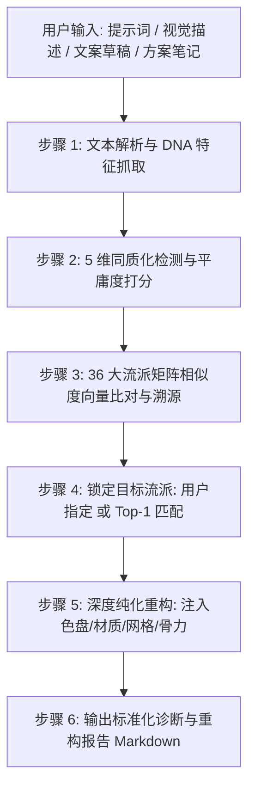

# 接口规范：反重力风格分析与同质化诊断接口 (`style-analyzer`)

> 本接口为 AI 设计美学知识体系的核心诊断组件，直通底层 36 大世界设计与叙事流派语料库（20 视觉 + 16 叙事）及集中特征索引矩阵 [`corpus_index.json`](file:///f:/ai风格设计/corpus_index.json)。

---

## 1. 接口定位与核心使命 (Mission & Architecture)

在 AI 图像与文本生成时代，通用大语言模型与扩散模型天然倾向于收敛至统计学上的**平庸众数**（表现为塑料高光、浮夸渐变、大头居中、公关套话）。

`style-analyzer` 接口作为**“AI 审美质检员与重构架构师”**，承担以下四大核心职能：
1. **流派溯源 (Lineage Tracing)**：以全球近现代 36 大设计与修辞语料库为基准，精确量化输入内容与各历史流派的契合度及置信度。
2. **设计基因提取 (DNA Extraction)**：精准提炼输入内容的色彩 HEX、时代物理材质、空间排版网格度规及文字修辞语法。
3. **AI 同质化审计诊断 (Anti-Homogenization Audit)**：对输入进行 5 维同质化检测，计算「AI 平庸度指数 (0-100%)」并出具扣分清单。
4. **深度纯化重构引擎 (Deep Purification)**：剔除平庸模板杂质，注入受限色盘与时代物理锚点，输出工业级生图 Prompt（Midjourney v6.1 / SDXL）与风骨文案。

---

## 2. 5 维 AI 同质化审计指标与扣分规约 (Diagnostic Rubric)

诊断引擎设定总基准分 100 分，根据检出的 AI 模板病征实施扣分：

| 维度 ID | 审查维度 | 核心同质化特征 (Anti-Patterns) | 扣分权重 | 矫正与纯化法则 |
| :--- | :--- | :--- | :---: | :--- |
| **DIM-01** | **材质塑料感与 3D 渲染高光** | 滥用 `octane render`, `unreal engine 5`, `volumetric lighting`, `subsurface scattering`, `glossy plastic`, `超逼真`, `油腻高光` | 单次 -5<br>(上限 -25) | 强制锚定生宣水渗、粗糙木模清水混凝土、生铁氧化、冷轧钢管等时代物理材质。 |
| **DIM-02** | **色彩媚俗与霓虹渐变滥用** | 滥用 `cyberpunk neon`, `purple and blue`, `macaron gradient`, `水果糖渐变`, `蓝紫霓虹`, `无端彩虹光` | 单次 -5<br>(上限 -20) | 废除无脑渐变，严格使用受限特调色盘（2-4色），明确 60:30:10 阶梯配比。 |
| **DIM-03** | **空间臃肿与大头居中填满** | 滥用 `centered subject`, `crowded composition`, `extreme bokeh`, `大头居中`, `填满画面`, `缺乏呼吸感` | 单次 -5<br>(上限 -20) | 强制引入数学多栏网格（12-Column Grid）或极端不对称构图，规定留白率 ≥65%。 |
| **DIM-04** | **假大空公关辞令与廉价鸡汤** | 滥用“赋能”、“闭环”、“链路”、“极致体验”、“未来可期”、“温馨”、“治愈”、“岁月静好”、“温柔以待”等公关八股 | 单次 -5<br>(上限 -20) | 坚决剔除虚无形容词，采用动名词骨力结构、短句白描切割或具象微观感官通感。 |
| **DIM-05** | **精神骨力与微观物理锚点缺失** | 滥用 `beautiful`, `luxury`, `amazing`, `高端大气`, `梦幻`, `意境深远` 等毫无信息量的空洞吹捧词 | 单次 -3<br>(上限 -15) | 禁用空洞形容词，必须以客观技术数据、具象时代物象与克制文字构建张力。 |
| **DIM-06** | **样板戏人设与“吃了不烧心”刻奇** | 滥用“咬着没点的烟”、“是它的本分”、“先把规矩立住”、“吃了不烧心”等低成本道德与认知爽感民间哲人剧本 | 单次 -5<br>(上限 -20) | 剥离扫地僧式装逼，还原真实的世俗疲倦、利益算计、粗糙毛刺、无效碎嘴与尴尬。 |
| **DIM-07** | **叙事潜台词直白化与金句强迫症** | 生怕读者看不懂而在公文中直接打出“致全体耗材”、“期待你的下一具遗体”，或尾段必强加二律背反预制金句 | 单次 -5<br>(上限 -20) | 严格恪守死鱼眼冷面笑匠法则（Deadpan），越荒谬越要官方正经，留白由读者心领神会。 |

### 评级梯度表：
- **`0 - 15%` 纯血正统 (Authentic Masterpiece)**：具备极高辨识度与时代物质真实感，PASS ✅
- **`16 - 40%` 轻度泛化 (Slightly Homogenized)**：含有少量常见套路，建议局部纯化，WARNING 🟡
- **`41 - 70%` 严重同质化 (Severely Homogenized)**：充斥典型模板病征，必须全面重构，FAIL 🔴
- **`71 - 100%` 重度 AI 废料 (Generic AI Sludge)**：毫无灵魂与骨力，属完全报废级生成物，CRITICAL 💀

---

## 3. 调用协议与交互流 (Protocol & Execution Flow)

当 Agent 或用户调用 `style-analyzer` 时，执行如下标准化流水线：



### 自动化执行支持：
本接口提供底层无依赖 Python 核心引擎支持，可通过命令行即刻执行：
```bash
# 分析文本或提示词
python scripts/style_analyzer.py --input "你的设计描述或Midjourney提示词"

# 指定目标纯化流派 (例如强制向新中式纯化)
python scripts/style_analyzer.py --input "..." --target style-neo-chinese-zen

# 输出结构化 JSON 供上层程序消费
python scripts/style_analyzer.py --input "..." --json
```

---

## 4. 输出标准规约 (Output Specification Template)

每次调用 `style-analyzer`，返回的内容必须严格包含以下四大核心版块：

```markdown
# 🧬 反重力风格与同质化诊断报告 (Style Analysis & Diagnostics)

**输入分析内容**：[用户原始输入文本]

## 1. AI 同质化与平庸度诊断 [状态指示符：🟢 / 🟡 / 🔴]
- **同质化指数 (Homogenization Index)**: `[0-100]/100` ([评级名称])
- **合规评估结果**: `[PASS / WARNING / FAIL / CRITICAL]`
- **扣分明细与风险项**：
  1. [扣分维度] (扣分: -X)
     - 命中通病词汇: `[...]`
     - 矫正法则: [...]

## 2. 设计基因提取 (Design DNA Extraction)
- **显式 HEX 色彩**: `[#HEX1, #HEX2...]` 或未显式指定
- **推断色彩映射**: [由色彩名词推导出的标准色卡]
- **微观物理材质**: [提取的具体物质：如生宣纸、无缝钢管、清水混凝土]
- **构图与网格律令**: [提取的空间排版方式：如 12 栏网格、不对称、留白率]
- **修辞句式特征**: [提取的文字修辞法则：如短句白描、事实密集、冷面反讽]

## 3. 流派溯源与匹配置信度 (Style Lineage Tracing)
### 🎨 视觉流派匹配排行 (Top Visual Styles):
1. **[流派全称]** (`[流派ID]`) - 匹配度: **[XX]%** [[置信度等级]]
   - 判定依据: [命中特征词/标签/调色盘证据]
   - 官方推荐修辞搭档: [协同 voice 技能]
2. ...

### ✍️ 叙事修辞流派匹配排行 (Top Narrative Styles):
1. **[修辞流派全称]** (`[流派ID]`) - 匹配度: **[XX]%** [[置信度等级]]
   - 判定依据: [命中的修辞句式/意象/语法证据]
   - 官方推荐视觉搭档: [协同 style 技能]
2. ...

## 4. 深度纯化重构方案 (Deep Purification Engine)
**目标流派锁定**：`[目标流派中文名]` (`[流派ID]`)

### 🎯 纯化重构图像生成提示词 (Midjourney v6.1 / SDXL 工业级资产):
```text
[结构化 Positive Prompt，包含 Subject + 物理材质 + 特调色盘 + --ar 16:9 --style raw --v 6.1]
```
### 🚫 硬性负向禁忌词 (Negative Prompt):
```text
[流派专用负向约束池 + 本次检测检出的同质化触发词合集]
```
- **受限特调色盘**: `[#HEX1 | #HEX2 | #HEX3 | #HEX4]`
- **执行改造关键步骤**:
  1. ...
  2. ...
```

---

## 5. 全真落地案例演练 (Exemplars)

### 案例 1：视觉生图提示词同质化诊断与纯化

#### 用户原始输入：
> `A futuristic electric tea maker, octane render, unreal engine 5, 8k wallpaper, volumetric lighting, glossy purple and blue neon, centered, cinematic lighting, cute and healing.`

#### 接口诊断与纯化输出：
- **同质化指数**：**`65/100` (严重同质化 FAIL 🔴)**
- **检出病征**：
  - 材质塑料感与 3D 渲染高光：命中 `octane render`, `unreal engine 5`, `volumetric lighting` (-25分)
  - 色彩媚俗与霓虹泛滥：命中 `purple and blue neon` (-10分)
  - 空间大头居中：命中 `centered` (-10分)
  - 鸡汤无病呻吟：命中 `healing` (-5分)
  - 空洞形容词：命中 `cute`, `cinematic` (-6分)
- **流派溯源定位**：茶器具文化与当代东方写意契合度最高，锁定 `style-neo-chinese-zen`（当代东方文人写意）。
- **纯化重构 Midjourney Prompt**：
  > `Definitive Contemporary Neo-Chinese literati minimalism, architectural product shot of a contemporary electric tea maker made of unglazed slate-gray matte ceramic and cold-formed dark bamboo handle. Placed on an asymmetrical reclaimed wood surface with subtle water stain marks, 65% empty negative space, soft overcast morning window skylight, delicate bamboo shadow projection on pale rice paper wall (#F5F2EB #2C2F33 #3D4C53 #8A9A86). Ultra-refined craftsmanship, Hasselblad medium format color fidelity. --ar 16:9 --style raw --v 6.1`
- **负向禁忌词**：
  > `gold, shiny dragon, red lanterns, oversaturated colors, cyberpunk neon, purple and blue, glossy plastic, 3d render shine, octane render, unreal engine 5, volumetric lighting, centered composition.`

---

### 案例 2：品牌文案同质化诊断与纯化

#### 用户原始输入：
> `在当今快节奏的社会中，我们致力于为都市青年打造全方位极致体验，以科技赋能生活，让每一刻都充满温馨与治愈，未来可期。`

#### 接口诊断与纯化输出：
- **同质化指数**：**`80/100` (重度 AI 废料 CRITICAL 💀)**
- **检出病征**：典型互联网公关黑话与廉价鸡汤大杂烩（“在当今快节奏的社会中”、“全方位”、“极致体验”、“赋能”、“温馨”、“治愈”、“未来可期”）。
- **流派溯源定位**：若面向硬核独立产品，锁定 `voice-luxun`（鲁迅冷峻匕首体）；若面向新锐东方生活方式，锁定 `voice-neo-oriental`（新东方风土嗅觉体）。
- **纯化重构文案示范（以新东方风土嗅觉体纯化）**：
  > 慢下来，与一缕松针的冷香静坐。  
  > 窗外车马喧腾，屋里水汽渐生。  
  > 不是为了逃离什么，只是在日落前，留得这一寸山林清凉。  
  > （严格遵守零形容词法则，以具象风土与清冷短句取缔虚无口号）。

---

## 6. 与其他模块的协作拓扑

- 前置调用：接收用户直接需求，或作为设计审核环节接入。
- 协同调用：诊断完成后，将提取的风格 DNA 与纯化参数传递给 [`style-designer`](file:///f:/ai风格设计/skills/interfaces/style-designer/SKILL.md) 智能设计调度器，进行工业级落地方案排期与生产。
